  
  

## 👋 Hi there

I'm John, a developer with background in ERP systems.
- Currently, I work in consulting & developing software solutions for clients;
- Interest in make projects that can be useful and meaningful for everyone.

## 💼 Work Experience

| Position               | Company          | Field                        | Work period       | 
| ---                    | ---              | ---                          | ---               |
| **Software Developer** | **TOTVS**        | **Custom software**          | **2025-11 — now** |
| Software Developer     | CASP             | Sales software & Legacy code | 2024-08 — 2025-11 |
| Planning Analyst       | JAGUAR PLÁSTICOS | Production planning          | 2022-08 — 2024-08 |

## 🎓 Education

- Bachelor's degree @ State University of Campinas (2020 — 2025)

## 🛠️ Technologies I use

